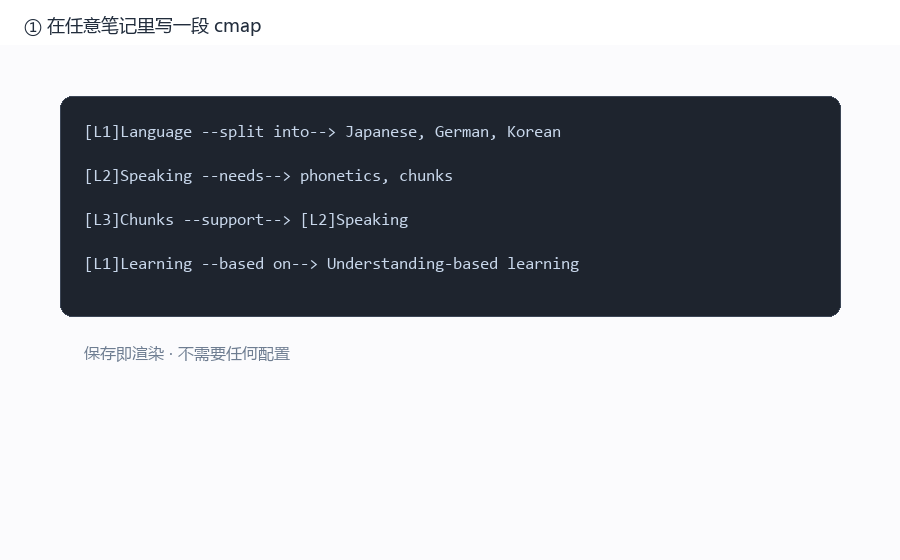

# 3D Concept Map

**Turn your notes into a rotatable 3D concept network.**
Write a `cmap` block, get a graph you can spin, zoom and click. Or press one button and let the plugin build concept pages from your whole vault.

**把笔记变成立体概念网络。** 写一段 `cmap` 代码块，就能得到可旋转、可缩放、可点开的概念图；也可以一键扫描全库，自动生成概念页与索引。



---

## 一、安装 · Install

| 方式 | 步骤 |
|---|---|
| **Community store** | Settings → Community plugins → Browse → search **3D Concept Map** → Install → Enable |
| **BRAT** | Install BRAT → `BRAT: Add a beta plugin` → `jaegerzhang001-max/3d-concept-map` |
| **Manual** | Download `main.js`, `manifest.json`, `styles.css` from the latest release into `.obsidian/plugins/three-d-concept-map/`, reload, enable |

Requires Obsidian **1.5+**. Works on desktop and mobile (3D is heavier on phones).

---

## 二、手动写一个小网络 · Build a small network by hand

新建任意笔记，写一个 `cmap` 代码块：

````md
```cmap
[L1]Language --split into--> Japanese, German, Korean
[L2]Speaking --needs--> phonetics, chunks
[L3]Chunks --support--> [L2]Speaking
[L1]Learning --based on--> Understanding-based learning
```
````

保存后立即渲染成 3D 球。**这一步是只读的，不会创建或修改任何文件。**

### 语法 · Syntax

| 写法 | 含义 |
|---|---|
| `A --relation--> B` | 一条有向关系（连词必须写） |
| `A --relation--> B, C, D` | 一对多，自动生成中间「站」再分叉 |
| `[L1]`…`[L5]` | 层级，决定球的**大小与颜色**（可在设置里改名） |
| `%%` 开头 / 空行 | 忽略 |

### 交互 · Interaction

| 操作 | 效果 |
|---|---|
| 点击概念 | 聚焦它和两跳内的邻居，其余隐去 |
| 点空白 / ✕ | 恢复全图 |
| 左键拖动 | 旋转 |
| 右键 / Shift 拖动 | 平移 |
| 滚轮 | 缩放 |
| 重置 / 全屏 | 视角复位 / 铺满窗口 |
| 选中后操作条 | 🗺 打开概念图 · 📄 打开笔记 · 🔍 全库搜索 |

---

## 三、自动生成整个网络 · Auto-build the whole network


如果你已经有一堆笔记，不想手写每一条关系：

1. **设置 → 3D Concept Map**
   - **Concept folder**：生成物放在哪（默认 `Concepts`）
   - **Classification rules**：每行 `folder=concept`，例如 `Journal=每日思考`、`Projects=项目复盘`
   - **Level names**：把 L1–L5 改成你自己的分层名（留空则隐藏图例）
2. 点左侧工具栏 **「构建概念网络 / Build concept network」**（或命令面板同名命令）
3. 插件会：
   - 扫描全库 `cmap` 块，抽取三元组
   - 把未归类的笔记按「标题命中已有概念」或「分类规则」挂上去
   - 在概念目录生成 `Concept/<名字>.md` 与 `Concept index.md`
   - 弹出结果：`N concepts / M relations`
4. 之后每次改完笔记，再点一次即可增量更新（未变化的页面会跳过）

### 自动生成示例 · What it produces

```
Concepts/
├─ 概念索引.md              ← all concepts ranked by connections
├─ 概念/
│   ├─ 理解型学习.md        ← 3D 关系图 + 它指向 / 指向它 + 相关笔记
│   ├─ 学习故事.md
│   └─ …
└─ 旧概念/                  ← 已被移除概念的历史页（不删除）
```

每个概念页顶部就是它自己的 3D 图，点图里的球可以一路跳下去：

**概念 → 邻居概念 → 再下钻 → 没有页面时自动搜索全库**

---

## 四、安全边界 · Safety

- 渲染 `cmap`：**只读**，不写文件
- 构建网络：**只写**你设置的概念目录，绝不碰其他笔记
- 生成页带标记 `generated_by: three-d-concept-map`；**同名但无标记的文件（你自己的笔记）绝不覆盖**
- 概念被移除后，旧页面移到 `旧概念/`，**从不删除**
- 不联网、无遥测、无外部程序调用

---

## 五、适合 / 不适合 · Good for / Not for

| 适合 | 不适合 |
|---|---|
| 想看见自己知识的结构 | 想自动抽取论文里的概念（本插件不做 NLP） |
| 用「概念—连词—概念」整理笔记 | 想要思维导图那种纯树状分支 |
| 几十到几千篇笔记的中文/英文库 | 需要协作编辑同一个图 |

---

## 六、常见问题 · FAQ

**Q：为什么点「构建」没反应？**
A：先看有没有弹出「开始构建概念网络…」。没有的话，用命令面板执行同名命令；有的话，等提示变成「概念网络已更新」即可（大库需要几十秒，期间会显示进度）。

**Q：会改我的笔记吗？**
A：不会。构建只写概念目录；同名用户文件会被跳过并在提示里告诉你数量。

**Q：层级只能用 5 层吗？**
A：`[L1]`–`[L5]`，默认五层；名称可自定义。

---

MIT © Jäger Zhang · [Repository](https://github.com/jaegerzhang001-max/3d-concept-map)
