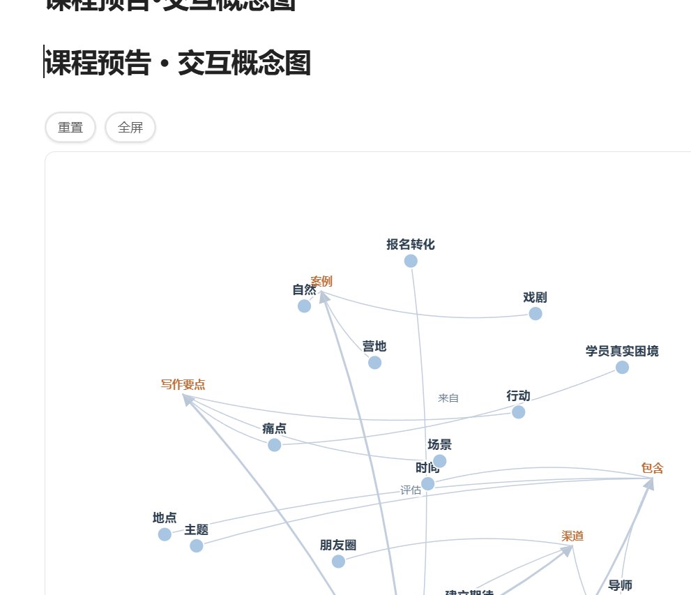

# 3D Concept Map

**中文简介**：把 Obsidian 笔记变成立体概念网络的插件。在任意笔记里写 `cmap` 代码块，就能得到一张可旋转、可缩放、可点开的 3D 知识图谱；再点一下「构建概念网络」，插件会扫描全库、自动生成概念页与概念索引。

- 安装：设置 → 第三方插件 → 浏览 → 搜索 **3D Concept Map**（或用 BRAT 填 `jaegerzhang001-max/3d-concept-map`）
- 用法：写 `cmap` 代码块 → 点节点聚焦 → 拖动旋转 → 右键平移
- 构建：设置里填分类规则（`文件夹=概念`），点左侧「构建概念网络」



---

Turn your vault into an interactive 3D concept network. Write `cmap` blocks to get a rotatable, zoomable concept graph, and use the built-in builder to turn your notes into concept pages.


## Installation

### From the community directory
1. Open **Settings → Community plugins** and turn off Restricted mode.
2. Click **Browse** and search for **3D Concept Map**.
3. Click **Install**, then **Enable**.

### Manual
1. Download `main.js`, `manifest.json`, and `styles.css` from the latest release.
2. Put them in `.obsidian/plugins/three-d-concept-map/`.
3. Reload Obsidian and enable the plugin in **Community plugins**.

### BRAT (beta)
1. Install the **BRAT** plugin.
2. Run `BRAT: Add a beta plugin` and enter `jaegerzhang001-max/3d-concept-map`.

## Usage

Write a `cmap` code block in any note:

```cmap
[L1]Language --split into--> Japanese, German, Korean
[L2]Speaking --needs--> phonetics, chunks
[L3]Chunks --support--> [L2]Speaking
```

Syntax:

| Syntax | Meaning |
|---|---|
| `[L1]` `[L2]` `[L3]` | Level, controls node size and color |
| `A --relation--> B, C` | One-to-many, rendered as a fan-out with a labeled station |
| `A --relation--> B` | Direct relation |

Interactions:

| Action | Result |
|---|---|
| Click a node | Focus it and its two-hop neighbors |
| Click empty space | Restore the full graph |
| Drag (left) | Rotate the sphere |
| Drag (right / Shift) | Pan |
| Wheel | Zoom |
| Reset / Fullscreen | Reset the view / fill the window |

## Building a concept network

1. Go to **Settings → 3D Concept Map** and set **Classification rules** (`folder=concept`, one per line).
2. Click the **Build concept network** ribbon icon, or run the command with the same name.
3. The plugin creates `Concept/<name>.md` pages and a `Concept index.md`.

## Settings

- Concept folder (default `Concepts`)
- Node size
- Show relation labels
- Auto-rotate
- Auto-link notes that are not in the network yet
- Classification rules

## 中文说明

把 `cmap` 代码块渲染成可交互的 3D 概念网络；内置构建器可扫描全库生成概念页与概念索引。

安装：设置 → 第三方插件 → 浏览 → 搜索 **3D Concept Map** → 安装 → 启用。

用法：在笔记中写 `cmap` 代码块（见上表语法），即可得到 3D 图；点节点聚焦、拖动旋转、右键平移、滚轮缩放。

构建概念网络：设置里填 `文件夹=概念` 的分类规则，点左侧「构建概念网络」图标。

## License

MIT © Jäger Zhang
